<p align="center"></p>

<h1 align="center">OPA Studio <code>v0.4.9</code></h1>

<p align="center"><b>The web UI for every Open Policy Agent operation — built, tested and documented for <a href="https://github.com/open-policy-agent/opa/releases/tag/v0.4.9">OPA v0.4.9</a>.</b></p>

<p align="center">   <a href="LICENSE"></a></p>

> **One Studio release per OPA release.** This is tag [`v0.4.9`](https://github.com/alasgarovnamig/OPA-Studio/tree/v0.4.9) of OPA Studio and it targets **OPA v0.4.9** exactly: the image bundles that OPA binary, the UI only offers what that release can do, and the example workspace is written in its Rego dialect. Using another OPA version? Pick the matching tag in [docs/VERSIONS.md](https://github.com/alasgarovnamig/OPA-Studio/blob/main/docs/VERSIONS.md).

<p align="center"><a href="https://github.com/alasgarovnamig/OPA-Studio/tree/v0.4.8">← v0.4.8</a> · <a href="https://github.com/alasgarovnamig/OPA-Studio/blob/main/docs/VERSIONS.md">All versions</a> · <a href="https://github.com/alasgarovnamig/OPA-Studio/tree/v0.4.10">v0.4.10 →</a></p>

OPA Studio lets you do everything OPA can do from a browser: manage policies and data on any number of OPA servers, evaluate, test, format, benchmark, build and sign policies with the OPA CLI, use the REPL, and act as the control plane OPA agents download bundles from and report decisions and status to. Nothing you can do with OPA v0.4.9 is out of reach — see the [feature coverage](docs/feature-coverage.md).

**Docs:** [Feature coverage](docs/feature-coverage.md) · [Compatibility](docs/compatibility.md) · [Configuration](docs/configuration.md) · [Security](docs/security.md) · [HTTP API](docs/api.md) · [Architecture](docs/architecture.md) · [Development](docs/development.md)

<p align="center">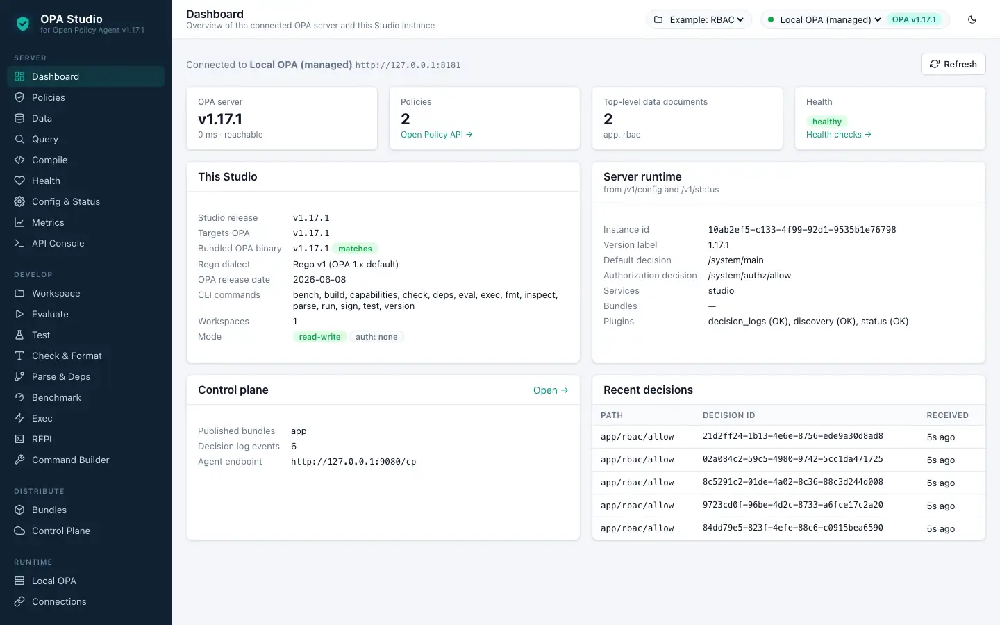</p>

## Contents

- [Quick start](#quick-start)
- [What OPA v0.4.9 can do](#what-opa-v049-can-do)
- [What changed in OPA v0.4.9](#what-changed-in-opa-v049)
- [Guided tour](#guided-tour)
- [Connect OPA agents to Studio](#connect-opa-agents-to-studio)
- [Configuration](#configuration)
- [Verification](#verification)
- [Build from source](#build-from-source)
- [Other OPA versions](#other-opa-versions)

## Quick start

```bash
docker run --rm -p 9080:9080 -v opa-studio:/var/lib/opa-studio ghcr.io/alasgarovnamig/opa-studio:v0.4.9
```

Open <http://localhost:9080>. Studio starts a managed OPA v0.4.9 server, creates an example workspace and connects to it.
Container platforms for this release: `linux/amd64` (determined by the binaries OPA v0.4.9 ships).

Connect to your own OPA v0.4.9 server instead (or in addition):

```bash
docker run --rm -p 9080:9080 \
  -e OPA_STUDIO_CONNECTIONS='[{"id":"prod","name":"Production","url":"http://opa.internal:8181","token":"…"}]' \
  -e OPA_STUDIO_AUTH_MODE=basic -e OPA_STUDIO_BASIC_PASSWORD='change-me' \
  ghcr.io/alasgarovnamig/opa-studio:v0.4.9
```

Standalone binaries (Studio + matching OPA) are attached to the [GitHub release](https://github.com/alasgarovnamig/OPA-Studio/releases/tag/v0.4.9) for: `linux/amd64`, `darwin/amd64`.

## What OPA v0.4.9 can do

Measured by running the official OPA v0.4.9 binary (`b7bcefd`). Studio enables exactly these features.

### Rego dialect: Classic Rego (unification)

Rule bodies in braces with `=` unification; no `:=` / `==` yet.

The example workspace Studio creates for this release (`app/rbac.rego`):

```rego
package app.rbac

# Role-based access control example shipped with OPA Studio.

user_roles = {"alice": ["admin"], "bob": ["employee", "billing"], "eve": ["customer"]}

role_grants = {
	"customer": [{"action": "read", "type": "dog"}, {"action": "adopt", "type": "dog"}],
	"employee": [{"action": "read", "type": "dog"}, {"action": "update", "type": "dog"}],
	"billing": [{"action": "read", "type": "finance"}, {"action": "update", "type": "finance"}],
}

default allow = false

# Admins may do anything.
allow {
	user_is_admin
}

# Everybody else needs a grant for the action and type.
allow {
	user_is_granted[grant]
	input.action = grant.action
	input.type = grant.type
}

user_is_admin {
	user_roles[input.user][_] = "admin"
}

user_is_granted[grant] {
	role = user_roles[input.user][_]
	grant = role_grants[role][_]
}

reasons["access denied"] {
	not allow
}
```

### CLI commands (2)

| Command | Description | Flags | Studio page |
|---|---|---|---|
| `opa run` | Start OPA in interative or server mode | 13 | Local OPA, REPL · Command Builder |
| `opa version` | Print the version of OPA | 0 | About · Command Builder |

<details><summary>All flags of every command</summary>

**opa run**

| Flag | Type | Description |
|---|---|---|
| `--addr` `-a` | `string` | set listening address of the server (default ":8181") |
| `--authentication` | `{token,off}` | set authentication scheme (default off) |
| `--authorization` | `{basic,off}` | set authorization scheme (default off) |
| `--eval` `-e` | `string` | evaluate, print, exit |
| `--format` `-f` | `string` | set shell output format, i.e, pretty, json (default "pretty") |
| `--history` `-H` | `string` | set path of history file (default "/root/.opa_history") |
| `--insecure-addr` | `string` | set insecure listening address of the server |
| `--log-format` | `{text,json}` | set log format (default text) |
| `--log-level` `-l` | `{debug,info,error}` | set log level (default info) |
| `--server` `-s` | `bool` | start the runtime in server mode |
| `--tls-cert-file` | `string` | set path of TLS certificate file |
| `--tls-private-key-file` | `string` | set path of TLS private key file |
| `--watch` `-w` | `bool` | watch command line files for changes |

</details>

### REST API

| Capability | Endpoint | OPA v0.4.9 |
|---|---|---|
| Policy API — list | `GET /v1/policies` | ✅ |
| Policy API — create/update | `PUT /v1/policies/{id}` | ✅ |
| Policy API — delete | `DELETE /v1/policies/{id}` | ✅ |
| Data API — read root document | `GET /v1/data` | ✅ |
| Data API — decision with input | `POST /v1/data/{path}` | ✅ |
| Data API — write document | `PUT /v1/data/{path}` | ✅ |
| Data API — create-only (If-None-Match) | `PUT /v1/data/{path}` | ✅ |
| Data API — JSON Patch | `PATCH /v1/data/{path}` | ✅ |
| Data API — delete | `DELETE /v1/data/{path}` | — |
| Data API — v0 webhook | `POST /v0/data/{path}` | ✅ |
| Explanations (explain=full) | `?explain=full` | ✅ |
| Query API — GET | `GET /v1/query?q=` | ✅ |
| Query API — POST with input | `POST /v1/query` | — |
| Compile API — partial evaluation | `POST /v1/compile` | — |
| Compile API — data filtering (UCAST/SQL) | `POST /v1/compile/{path}` | — |
| Health API | `GET /health` | — |
| Health — bundles & plugins | `GET /health?bundles&plugins` | — |
| Health — custom live/ready policies | `GET /health/live, /health/ready` | — |
| Prometheus metrics | `GET /metrics` | — |
| Config API | `GET /v1/config` | — |
| Status API | `GET /v1/status` | — |

Every endpoint — including ones without a dedicated page — can be called from the **API Console**.

## What changed in OPA v0.4.9

Measured difference between OPA **v0.4.8** and **v0.4.9**:

| Change | Details |
|---|---|
| ➕ REST API | Data API — v0 webhook (`POST /v0/data/{path}`) |

<details><summary><b>Upstream release note highlights</b></summary>

- Basic type checking for queries and virtual docs
- Optimizations for HTTP API authorization policies
- New /v0 API to support webhook integrations (docs)

**Fixes**

- Add support for namespaced built-ins
- Improve logging to include request/response bodies
- Add basic performance metrics

**Miscellaneous**

- Add built-ins to un/marshal JSON
- Add input form to diagnostic page

Full notes: https://github.com/open-policy-agent/opa/releases/tag/v0.4.9

</details>

## Guided tour

Every screenshot below was captured automatically from OPA Studio `v0.4.9` running against OPA `v0.4.9`.

### 1. Dashboard

Connection health, server version, policy/data counts, runtime configuration and recent decisions at a glance.


- Pick the OPA server in the top bar (the managed **Local OPA** is selected by default).
- The cards show the server version, policy and data counts, health, configuration and the latest decisions.
- **Refresh** re-probes the server; a warning appears when its version differs from the one this release targets.

### 2. Workspace editor

Policies, data, inputs and tests of a workspace with Rego syntax highlighting, formatting, checks, deploy/pull, bundle import and export.

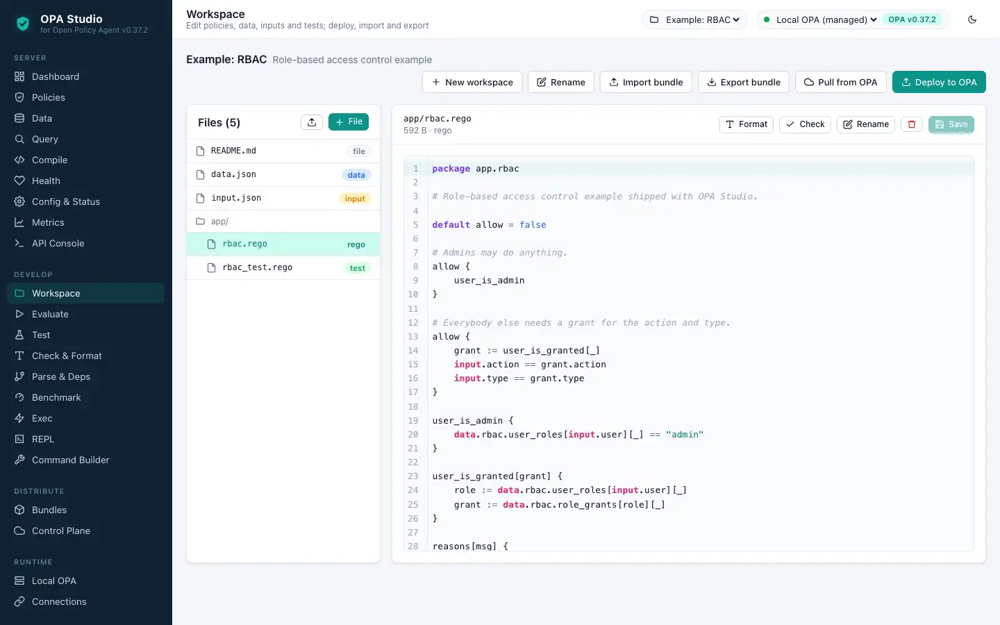

- Workspaces hold policies, tests, `data.json`/`data.yaml` documents and `input*.json` files; select one in the top bar.
- Click a file to edit it, <kbd>Ctrl/⌘</kbd>+<kbd>Enter</kbd> saves. **Format** and **Check** run `opa fmt` / `opa check` on the open file.
- **Deploy to OPA** uploads data (`PUT /v1/data`) and policies (`PUT /v1/policies`) to any connection; **Pull from OPA** does the reverse.
- **Import bundle** / **Export bundle** move the workspace in and out as an OPA bundle (`.tar.gz`).

### 3. Policy API

Lists, reads, creates, updates and deletes the Rego modules stored on the server (`/v1/policies`).

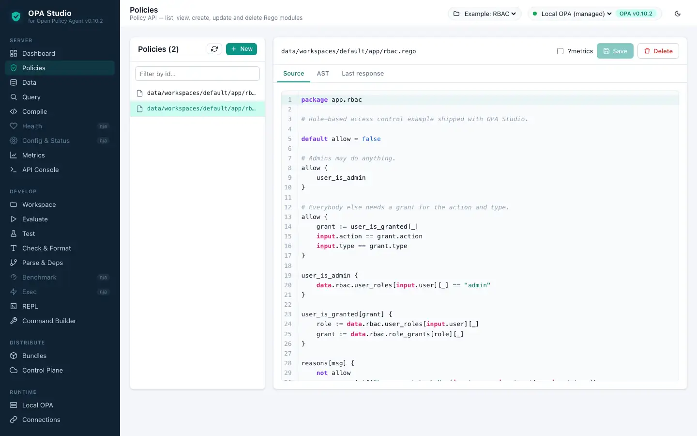

- Lists the modules stored on the server; select one to view or edit its source and AST.
- **New** creates a module from a starter written in this release's Rego dialect; **Delete** removes it.

### 4. Data API

Browse the document tree, query decisions with input, explanations, metrics and provenance, and write documents (PUT / PATCH / DELETE).

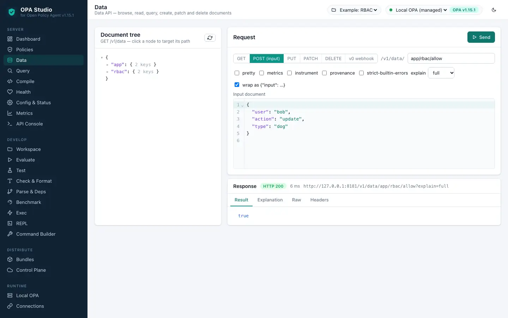

- Click a node in the document tree to target its path.
- GET / POST (with input) evaluate documents; PUT, PATCH (JSON Patch) and DELETE modify base documents.
- Explanations, metrics, instrumentation and provenance are rendered in their own tabs when the release supports them.

### 5. Query API

Ad-hoc Rego queries through `/v1/query` (GET and POST with input) and the default decision endpoint.

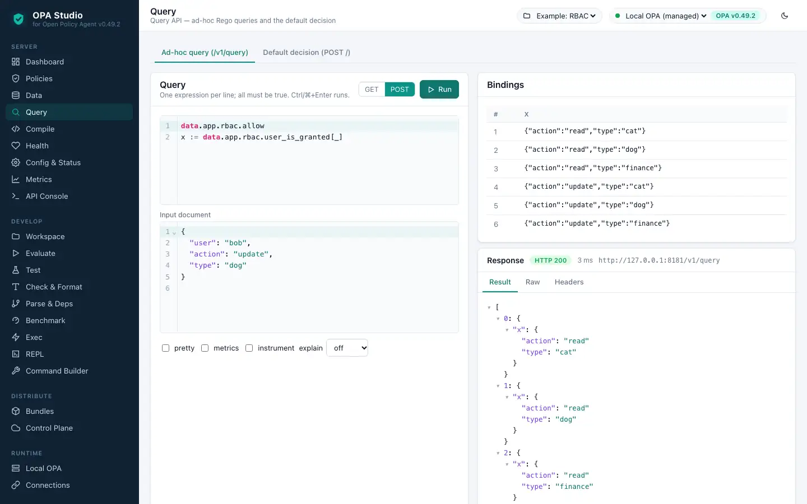

- Ad-hoc queries run through `/v1/query`; each line is an expression and variable bindings are shown as a table.
- The *Default decision* tab posts the request body to `POST /` when the release supports it.

### 6. Bundles

Build (`opa build`), inspect, sign and verify bundles; the native builder covers releases without `opa build`.

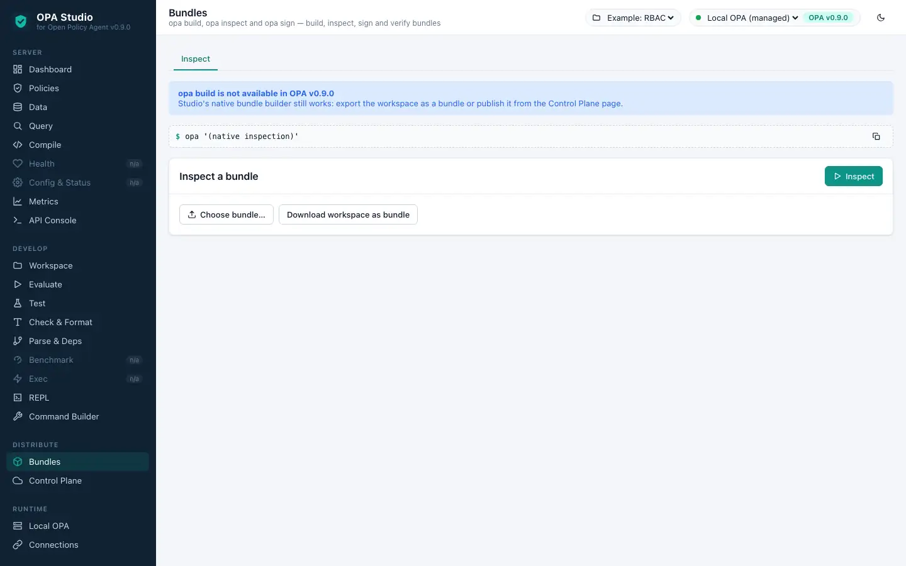

- **Build** runs `opa build` on the workspace (targets, entrypoints, optimisation, revision and signing when supported).
- Built bundles can be downloaded or published to the Studio control plane; **Inspect**, **Sign** and **Verify** work on any archive.

### 7. Control plane: decision logs

Studio serves bundles and discovery and receives decision logs and status reports from OPA agents.

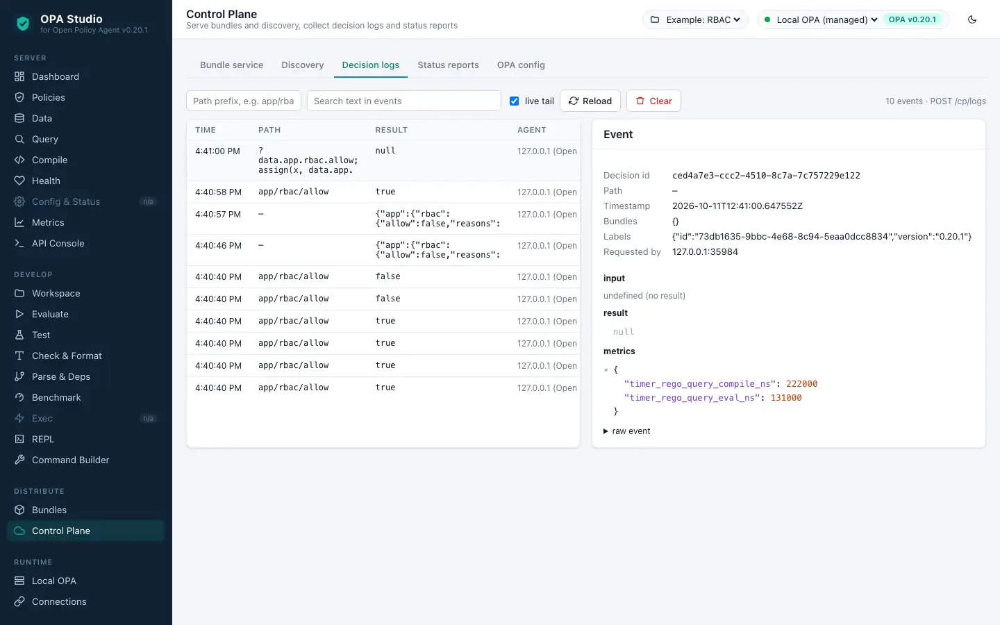

- Studio implements the OPA management APIs: bundle and discovery downloads, decision log and status uploads.
- The *OPA config* tab generates the agent configuration; *Apply to Local OPA* wires the managed server to Studio.
- Decision logs stream live; click a row for input, result, labels and metrics.

### 8. Local OPA

Start, stop and configure the managed OPA server; live process logs.

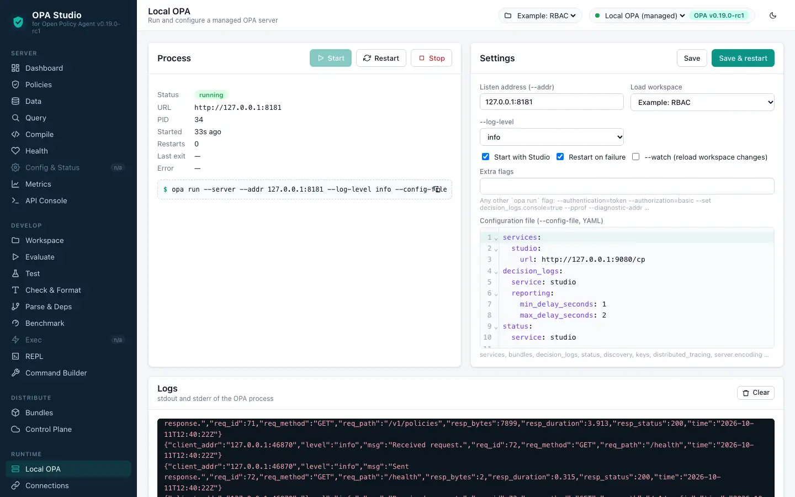

- Start, stop or restart the managed `opa run --server` process and change its address, loaded workspace, flags and configuration file.
- Process output is streamed live.

### 9. REPL (opa run)

The interactive Rego shell in the browser, with the workspace loaded.

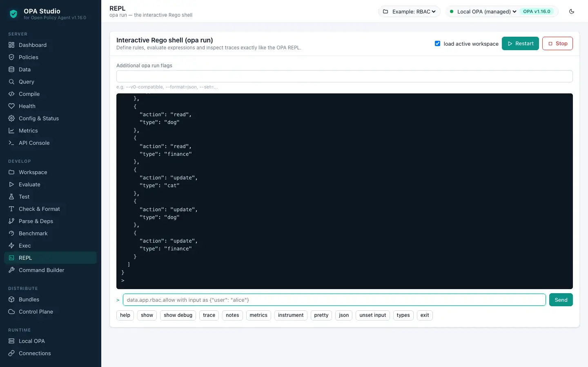

- **Start session** launches `opa run` with the workspace loaded; type Rego and REPL commands (`show`, `trace`, `metrics`, …).

### 10. Command Builder

Every command, subcommand and flag of this OPA release as a form — nothing the CLI can do is out of reach.

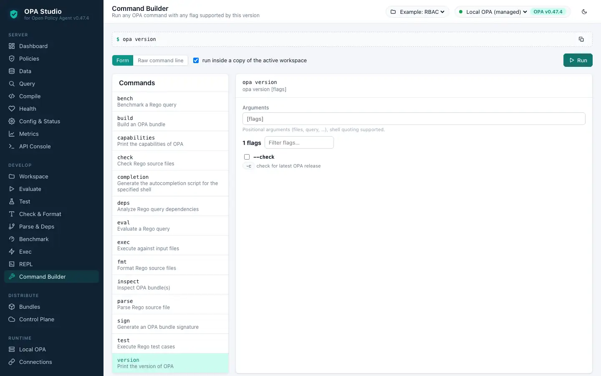

- Every command, subcommand and flag of this OPA binary is rendered as a form, generated from the measured manifest.
- Runs execute in a sandboxed copy of the workspace; output files can be collected and downloaded.

### 11. API Console

Any HTTP request against the OPA REST API with presets for every documented operation.

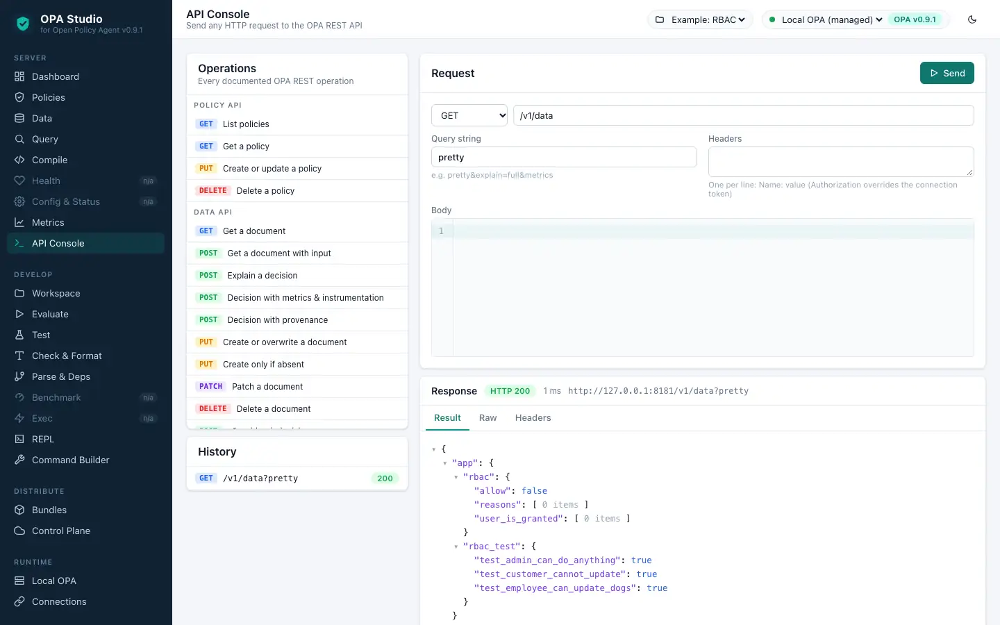

- Choose a preset (operations unavailable in this release are dimmed) or craft any request: method, path, query, headers and body.

### 12. Compatibility matrix

Measured capabilities of every OPA release and the changes introduced by this one.

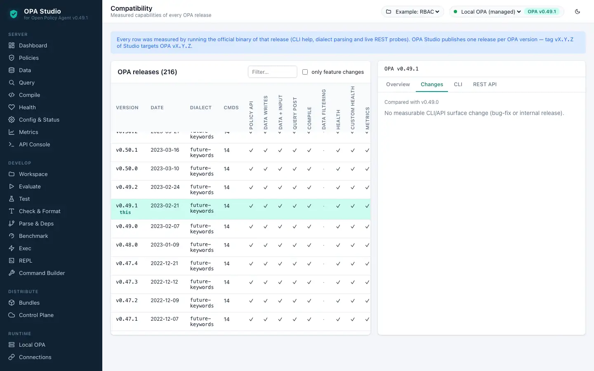

- The measured capability matrix of all OPA releases; select a release to see its commands, endpoints and changes.

> Pages not shown: Evaluate, Test, Check & Format, Benchmark, Exec, Bundle build, Bundle signing, Built-ins — OPA v0.4.9 does not have the corresponding CLI command, so Studio marks them *n/a*. Everything that exists in this release is covered.

## Connect OPA agents to Studio

Studio implements OPA's management APIs under `/cp`, so agents can download bundles from it and report decisions and status to it:

```yaml
services:
  studio:
    url: https://opa-studio.example.com/cp
    credentials:
      bearer:
        token: ${OPA_STUDIO_CONTROL_PLANE_TOKEN}
bundle:            # releases before v0.13.0 use the single 'bundle' key
  name: app
  service: studio
decision_logs:
  service: studio
status:
  service: studio
```

> OPA v0.4.9 has no `--config-file` flag, so it cannot use these plugins; Studio's bundle server still works with tools that download bundles.

The **Control Plane → OPA config** tab generates this file for you.

## Configuration

| Variable | Default | Purpose |
|---|---|---|
| `OPA_STUDIO_ADDR` | `:9080` | Listen address |
| `OPA_STUDIO_AUTH_MODE` | `none` | `none`, `basic` or `token` |
| `OPA_STUDIO_BASIC_USER` / `_PASSWORD` | `admin` / – | Credentials for basic auth |
| `OPA_STUDIO_AUTH_TOKEN` | – | Token for token auth (≥ 16 characters) |
| `OPA_STUDIO_READ_ONLY` | `false` | Reject every mutating operation |
| `OPA_STUDIO_CONNECTIONS` | – | JSON array (or `@file.json`) of OPA servers |
| `OPA_STUDIO_LOCAL_OPA` | `true` | Run the managed OPA v0.4.9 server |
| `OPA_STUDIO_CONTROL_PLANE_TOKEN` | – | Bearer token agents must send to `/cp` |
| `OPA_STUDIO_CLI_SANDBOX` | `true` | Reject absolute paths / traversal in CLI arguments |
| `OPA_STUDIO_TLS_CERT_FILE` / `_KEY_FILE` | – | Serve HTTPS |

All options: [docs/configuration.md](docs/configuration.md) · Security hardening: [docs/security.md](docs/security.md) · Kubernetes and Compose: [deploy/](deploy/).

## Verification

Automated checks run against OPA v0.4.9 for this release:

| Check | Result |
|---|---|
| `opa run --server` loads the workspace and decides | ✅ `{"result":true}` |
| UI pages exercised end-to-end | ✅ 12 pages, 0 failed actions |
| Browser console errors | ✅ none |
| Studio API server errors | ✅ none |

The Go unit tests, UI tests and the integration test (`OPA_BIN=… go test ./test/...`) run in CI for every tag.

## Build from source

```bash
git clone --branch v0.4.9 https://github.com/alasgarovnamig/OPA-Studio.git && cd OPA-Studio
make ui build          # web UI + bin/opa-studio (OPA version stamped from ./OPA_VERSION)
make opa               # downloads OPA v0.4.9 to bin/opa (checksum verified when published)
make run               # http://localhost:9080
make docker            # container image ghcr.io/alasgarovnamig/opa-studio:v0.4.9
```

Requirements: Go 1.23+, Node.js 20+, Docker (for images). See [docs/development.md](docs/development.md).

## Other OPA versions

| OPA Studio tag = OPA version | OPA released | Rego dialect |
|---|---|---|
| [v0.4.6](https://github.com/alasgarovnamig/OPA-Studio/tree/v0.4.6) | 2017-03-12 | Classic Rego (unification) |
| [v0.4.7](https://github.com/alasgarovnamig/OPA-Studio/tree/v0.4.7) | 2017-03-22 | Classic Rego (unification) |
| [v0.4.8](https://github.com/alasgarovnamig/OPA-Studio/tree/v0.4.8) | 2017-04-05 | Classic Rego (unification) |
| **v0.4.9** | 2017-05-16 | Classic Rego (unification) |
| [v0.4.10](https://github.com/alasgarovnamig/OPA-Studio/tree/v0.4.10) | 2017-05-31 | Classic Rego (unification) |
| [v0.5.0](https://github.com/alasgarovnamig/OPA-Studio/tree/v0.5.0) | 2017-07-05 | Classic Rego (unification) |
| [v0.5.1](https://github.com/alasgarovnamig/OPA-Studio/tree/v0.5.1) | 2017-07-10 | Classic Rego (unification) |

All 216 supported OPA releases: [docs/VERSIONS.md](https://github.com/alasgarovnamig/OPA-Studio/blob/main/docs/VERSIONS.md).

---

OPA Studio is an independent project and is not affiliated with the Open Policy Agent project or the CNCF. Licensed under [Apache-2.0](LICENSE).
