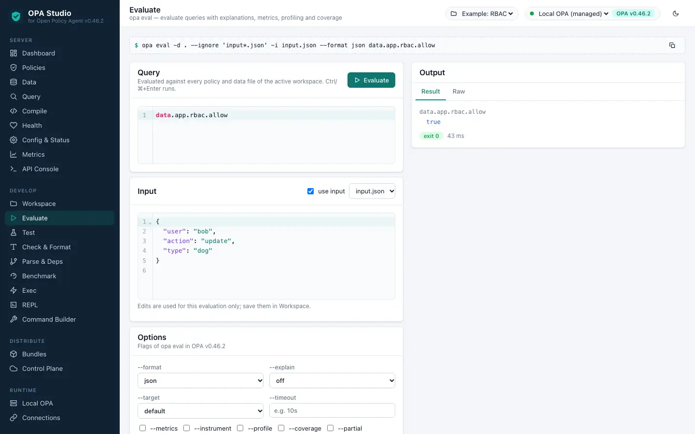
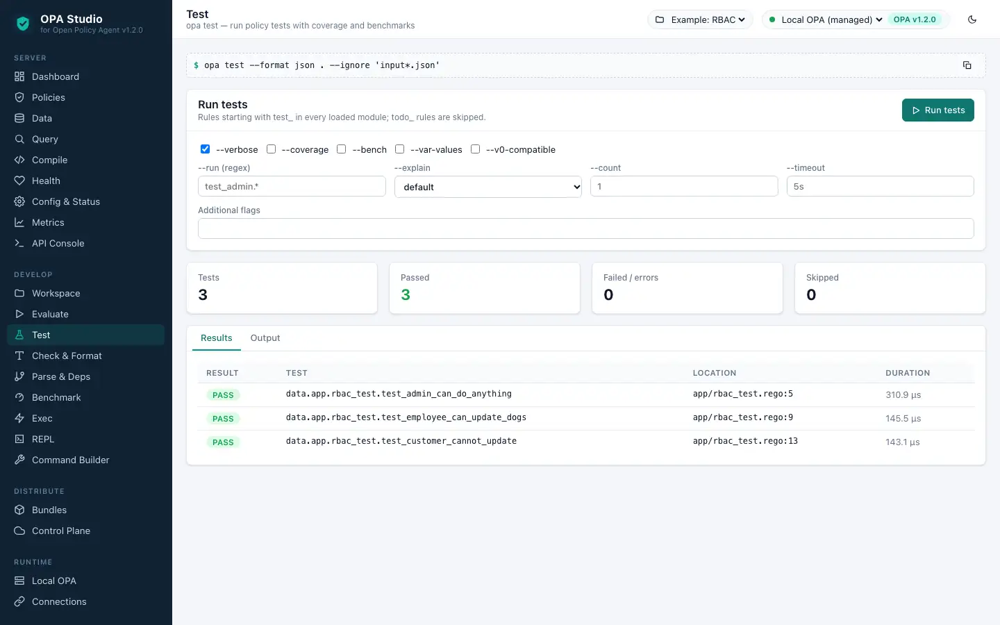
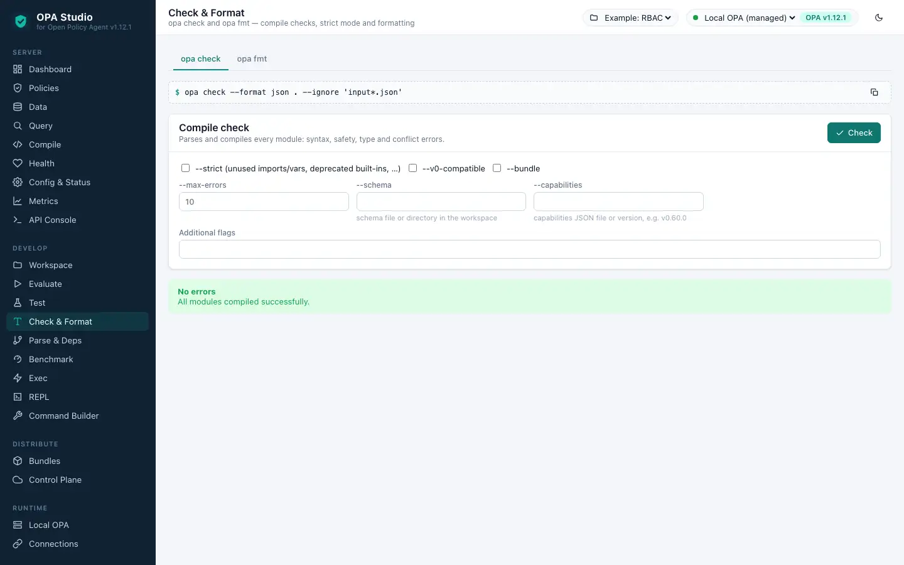
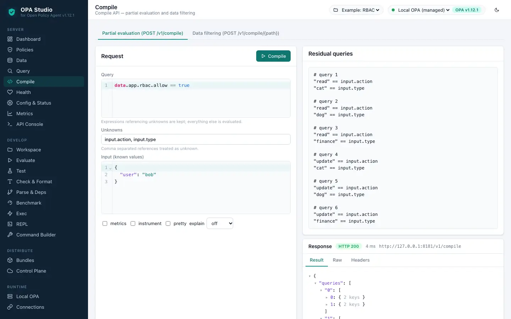
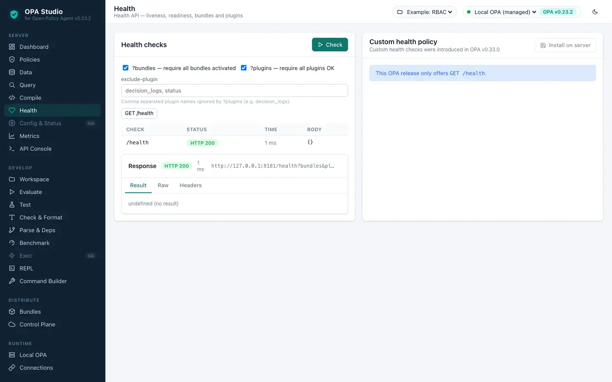
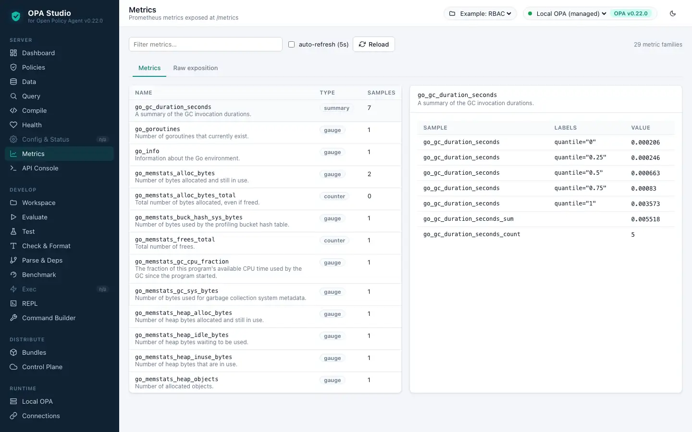

<p align="center"></p>

<h1 align="center">OPA Studio <code>v0.25.1</code></h1>

<p align="center"><b>The web UI for every Open Policy Agent operation — built, tested and documented for <a href="https://github.com/open-policy-agent/opa/releases/tag/v0.25.1">OPA v0.25.1</a>.</b></p>

<p align="center">   <a href="LICENSE"></a></p>

> **One Studio release per OPA release.** This is tag [`v0.25.1`](https://github.com/alasgarovnamig/OPA-Studio/tree/v0.25.1) of OPA Studio and it targets **OPA v0.25.1** exactly: the image bundles that OPA binary, the UI only offers what that release can do, and the example workspace is written in its Rego dialect. Using another OPA version? Pick the matching tag in [docs/VERSIONS.md](https://github.com/alasgarovnamig/OPA-Studio/blob/main/docs/VERSIONS.md).

<p align="center"><a href="https://github.com/alasgarovnamig/OPA-Studio/tree/v0.25.0">← v0.25.0</a> · <a href="https://github.com/alasgarovnamig/OPA-Studio/blob/main/docs/VERSIONS.md">All versions</a> · <a href="https://github.com/alasgarovnamig/OPA-Studio/tree/v0.25.2">v0.25.2 →</a></p>

OPA Studio lets you do everything OPA can do from a browser: manage policies and data on any number of OPA servers, evaluate, test, format, benchmark, build and sign policies with the OPA CLI, use the REPL, and act as the control plane OPA agents download bundles from and report decisions and status to. Nothing you can do with OPA v0.25.1 is out of reach — see the [feature coverage](docs/feature-coverage.md).

**Docs:** [Feature coverage](docs/feature-coverage.md) · [Compatibility](docs/compatibility.md) · [Configuration](docs/configuration.md) · [Security](docs/security.md) · [HTTP API](docs/api.md) · [Architecture](docs/architecture.md) · [Development](docs/development.md)

<p align="center"></p>

## Contents

- [Quick start](#quick-start)
- [What OPA v0.25.1 can do](#what-opa-v0251-can-do)
- [What changed in OPA v0.25.1](#what-changed-in-opa-v0251)
- [Guided tour](#guided-tour)
- [Connect OPA agents to Studio](#connect-opa-agents-to-studio)
- [Configuration](#configuration)
- [Verification](#verification)
- [Build from source](#build-from-source)
- [Other OPA versions](#other-opa-versions)

## Quick start

Build the image from this tag and run it — Docker is the only requirement:

```bash
git clone --branch v0.25.1 --single-branch https://github.com/alasgarovnamig/OPA-Studio.git opa-studio-v0.25.1
cd opa-studio-v0.25.1
docker build --platform linux/amd64 -t opa-studio:v0.25.1 .
docker run --rm --platform linux/amd64 -p 9080:9080 -v opa-studio-data:/var/lib/opa-studio opa-studio:v0.25.1
```

Open <http://localhost:9080>. Studio starts a managed OPA v0.25.1 server, creates an example workspace and connects to it.

> **Apple Silicon / ARM hosts:** OPA v0.25.1 ships no `linux/arm64` binary, so the image is built for `linux/amd64` (`--platform linux/amd64` above) and runs under emulation. On x86-64 machines the flag is harmless.

Connect to your own OPA v0.25.1 servers as well (and protect Studio with a password):

```bash
docker run --rm --platform linux/amd64 -p 9080:9080 -v opa-studio-data:/var/lib/opa-studio \
  -e OPA_STUDIO_CONNECTIONS='[{"id":"prod","name":"Production","url":"http://opa.internal:8181","token":"…"}]' \
  -e OPA_STUDIO_AUTH_MODE=basic -e OPA_STUDIO_BASIC_PASSWORD='change-me' \
  opa-studio:v0.25.1
```

With Docker Compose (builds the same image and starts an OPA agent wired to Studio's control plane): `OPA_STUDIO_BASIC_PASSWORD=change-me docker compose -f deploy/docker-compose.yml up --build`.

<details><summary>Prebuilt images and binaries</summary>

When the repository's release workflow has published this tag, the image can be pulled instead of built:

```bash
docker run --rm --platform linux/amd64 -p 9080:9080 -v opa-studio-data:/var/lib/opa-studio ghcr.io/alasgarovnamig/opa-studio:v0.25.1
```

The [GitHub release](https://github.com/alasgarovnamig/OPA-Studio/releases/tag/v0.25.1) then also carries archives with `opa-studio` and the matching `opa` binary for: `linux/amd64`, `darwin/amd64`, `windows/amd64`.

If the pull fails with `denied`, the image has not been published yet — build it as shown above.

</details>

## What OPA v0.25.1 can do

Measured by running the official OPA v0.25.1 binary (`5fc01b6`, go1.14.9). Studio enables exactly these features.

### Rego dialect: Classic Rego

Rule bodies in braces, `:=` assignment and `==` comparison; no `if` / `contains` keywords.

The example workspace Studio creates for this release (`app/rbac.rego`):

```rego
package app.rbac

# Role-based access control example shipped with OPA Studio.

default allow = false

# Admins may do anything.
allow {
	user_is_admin
}

# Everybody else needs a grant for the action and type.
allow {
	grant := user_is_granted[_]
	input.action == grant.action
	input.type == grant.type
}

user_is_admin {
	data.rbac.user_roles[input.user][_] == "admin"
}

user_is_granted[grant] {
	role := data.rbac.user_roles[input.user][_]
	grant := data.rbac.role_grants[role][_]
}

reasons[msg] {
	not allow
	msg := sprintf("%s may not %s %s", [input.user, input.action, input.type])
}
```

### CLI commands (11)

| Command | Description | Flags | Studio page |
|---|---|---|---|
| `opa bench` | Benchmark a Rego query | 14 | Benchmark · Command Builder |
| `opa build` | Build an OPA bundle | 17 | Bundles · Command Builder |
| `opa check` | Check Rego source files | 6 | Check & Format · Command Builder |
| `opa deps` | Analyze Rego query dependencies | 5 | Parse & Deps · Command Builder |
| `opa eval` | Evaluate a Rego query | 26 | Evaluate · Command Builder |
| `opa fmt` | Format Rego source files | 4 | Check & Format · Command Builder |
| `opa parse` | Parse Rego source file | 2 | Parse & Deps · Command Builder |
| `opa run` | Start OPA in interactive or server mode | 32 | Local OPA, REPL · Command Builder |
| `opa sign` | Generate an OPA bundle signature | 6 | Bundles · Command Builder |
| `opa test` | Execute Rego test cases | 14 | Test · Command Builder |
| `opa version` | Print the version of OPA | 2 | About · Command Builder |

<details><summary>All flags of every command</summary>

**opa bench**

| Flag | Type | Description |
|---|---|---|
| `--benchmem` | `bool` | report memory allocations with benchmark results (default true) |
| `--bundle` `-b` | `string` | set bundle file(s) or directory path(s). This flag can be repeated. |
| `--count` | `int` | number of times to repeat each benchmark (default 1) (default 1) |
| `--data` `-d` | `string` | set policy or data file(s). This flag can be repeated. |
| `--fail` | `bool` | exits with non-zero exit code on undefined/empty result and errors (default true) |
| `--format` `-f` | `{json,pretty,gobench}` | set output format (default pretty) |
| `--ignore` | `strings` | set file and directory names to ignore during loading (e.g., '.*' excludes hidden files) |
| `--import` | `string` | set query import(s). This flag can be repeated. |
| `--input` `-i` | `string` | set input file path |
| `--metrics` | `bool` | report query performance metrics (default true) |
| `--package` | `string` | set query package |
| `--stdin` | `bool` | read query from stdin |
| `--stdin-input` `-I` | `bool` | read input document from stdin |

**opa build**

| Flag | Type | Description |
|---|---|---|
| `--bundle` `-b` | `bool` | load paths as bundle files or root directories |
| `--capabilities` | `string` | set capabilities.json file path |
| `--claims-file` | `string` | set path of JSON file containing optional claims (see: https://openpolicyagent.org/docs/latest/management/#bundle-signature-format) |
| `--debug` | `bool` | enable debug output |
| `--entrypoint` `-e` | `string` | set slash separated entrypoint path |
| `--exclude-files-verify` | `strings` | set file names to exclude during bundle verification |
| `--ignore` | `strings` | set file and directory names to ignore during loading (e.g., '.*' excludes hidden files) |
| `--optimize` `-O` | `int` | set optimization level |
| `--output` `-o` | `string` | set the output filename (default "bundle.tar.gz") |
| `--revision` `-r` | `string` | set output bundle revision |
| `--scope` | `string` | scope to use for bundle signature verification |
| `--signing-alg` | `string` | name of the signing algorithm (default "RS256") |
| `--signing-key` | `string` | set the secret (HMAC) or path of the PEM file containing the private key (RSA and ECDSA) |
| `--target` `-t` | `{rego,wasm}` | set the output bundle target type (default rego) |
| `--verification-key` | `string` | set the secret (HMAC) or path of the PEM file containing the public key (RSA and ECDSA) |
| `--verification-key-id` | `string` | name assigned to the verification key used for bundle verification (default "default") |

**opa check**

| Flag | Type | Description |
|---|---|---|
| `--bundle` `-b` | `bool` | load paths as bundle files or root directories |
| `--capabilities` | `string` | set capabilities.json file path |
| `--format` `-f` | `{pretty,json}` | set output format (default pretty) |
| `--ignore` | `strings` | set file and directory names to ignore during loading (e.g., '.*' excludes hidden files) |
| `--max-errors` `-m` | `int` | set the number of errors to allow before compilation fails early (default 10) |

**opa deps**

| Flag | Type | Description |
|---|---|---|
| `--bundle` `-b` | `string` | set bundle file(s) or directory path(s). This flag can be repeated. |
| `--data` `-d` | `string` | set policy or data file(s). This flag can be repeated. |
| `--format` `-f` | `{pretty,json}` | set output format (default pretty) |
| `--ignore` | `strings` | set file and directory names to ignore during loading (e.g., '.*' excludes hidden files) |

**opa eval**

| Flag | Type | Description |
|---|---|---|
| `--bundle` `-b` | `string` | set bundle file(s) or directory path(s). This flag can be repeated. |
| `--coverage` | `bool` | report coverage |
| `--data` `-d` | `string` | set policy or data file(s). This flag can be repeated. |
| `--disable-indexing` | `bool` | disable indexing optimizations |
| `--disable-inlining` | `stringArray` | set paths of documents to exclude from inlining |
| `--explain` | `{off,full,notes,fails}` | enable query explanations (default off) |
| `--fail` | `bool` | exits with non-zero exit code on undefined/empty result and errors |
| `--fail-defined` | `bool` | exits with non-zero exit code on defined/non-empty result and errors |
| `--format` `-f` | `{json,values,bindings,pretty,source}` | set output format (default json) |
| `--ignore` | `strings` | set file and directory names to ignore during loading (e.g., '.*' excludes hidden files) |
| `--import` | `string` | set query import(s). This flag can be repeated. |
| `--input` `-i` | `string` | set input file path |
| `--instrument` | `bool` | enable query instrumentation metrics (implies --metrics) |
| `--metrics` | `bool` | report query performance metrics |
| `--package` | `string` | set query package |
| `--partial` `-p` | `bool` | perform partial evaluation |
| `--pretty-limit` | `int` | set limit after which pretty output gets truncated (default 80) |
| `--profile` | `bool` | perform expression profiling |
| `--profile-limit` | `int` | set number of profiling results to show (default 10) |
| `--profile-sort` | `string` | set sort order of expression profiler results |
| `--shallow-inlining` | `bool` | disable inlining of rules that depend on unknowns |
| `--stdin` | `bool` | read query from stdin |
| `--stdin-input` `-I` | `bool` | read input document from stdin |
| `--strict-builtin-errors` | `bool` | treat built-in function errors as fatal |
| `--unknowns` `-u` | `stringArray` | set paths to treat as unknown during partial evaluation (default [input]) |

**opa fmt**

| Flag | Type | Description |
|---|---|---|
| `--diff` `-d` | `bool` | only display a diff of the changes |
| `--list` `-l` | `bool` | list all files who would change when formatted |
| `--write` `-w` | `bool` | overwrite the original source file |

**opa parse**

| Flag | Type | Description |
|---|---|---|
| `--format` `-f` | `{pretty,json}` | set output format (default pretty) |

**opa run**

| Flag | Type | Description |
|---|---|---|
| `--addr` `-a` | `strings` | set listening address of the server (e.g., [ip]:<port> for TCP, unix://<path> for UNIX domain socket) (default [:8181]) |
| `--authentication` | `{token,tls,off}` | set authentication scheme (default off) |
| `--authorization` | `{basic,off}` | set authorization scheme (default off) |
| `--bundle` `-b` | `bool` | load paths as bundle files or root directories |
| `--config-file` `-c` | `string` | set path of configuration file |
| `--diagnostic-addr` | `strings` | set read-only diagnostic listening address of the server for /health and /metric APIs (e.g., [ip]:<port> for TCP, unix://<path> for UNIX domain socket) |
| `--exclude-files-verify` | `strings` | set file names to exclude during bundle verification |
| `--format` `-f` | `string` | set shell output format, i.e, pretty, json (default "pretty") |
| `--h2c` | `bool` | enable H2C for HTTP listeners |
| `--history` `-H` | `string` | set path of history file (default "/root/.opa_history") |
| `--ignore` | `strings` | set file and directory names to ignore during loading (e.g., '.*' excludes hidden files) |
| `--log-format` | `{text,json,json-pretty}` | set log format (default json) |
| `--log-level` `-l` | `{debug,info,error}` | set log level (default info) |
| `--max-errors` `-m` | `int` | set the number of errors to allow before compilation fails early (default 10) |
| `--pprof` | `bool` | enables pprof endpoints |
| `--ready-timeout` | `int` | wait (in seconds) for configured plugins before starting server (value <= 0 disables ready check) |
| `--scope` | `string` | scope to use for bundle signature verification |
| `--server` `-s` | `bool` | start the runtime in server mode |
| `--set` | `stringArray` | override config values on the command line (use commas to specify multiple values) |
| `--set-file` | `stringArray` | override config values with files on the command line (use commas to specify multiple values) |
| `--shutdown-grace-period` | `int` | set the time (in seconds) that the server will wait to gracefully shut down (default 10) |
| `--shutdown-wait-period` | `int` | set the time (in seconds) that the server will wait before initiating shutdown |
| `--signing-alg` | `string` | name of the signing algorithm (default "RS256") |
| `--skip-verify` | `bool` | disables bundle signature verification |
| `--skip-version-check` | `bool` | disables anonymous version reporting (see: https://openpolicyagent.org/docs/latest/privacy) |
| `--tls-ca-cert-file` | `string` | set path of TLS CA cert file |
| `--tls-cert-file` | `string` | set path of TLS certificate file |
| `--tls-private-key-file` | `string` | set path of TLS private key file |
| `--verification-key` | `string` | set the secret (HMAC) or path of the PEM file containing the public key (RSA and ECDSA) |
| `--verification-key-id` | `string` | name assigned to the verification key used for bundle verification (default "default") |
| `--watch` `-w` | `bool` | watch command line files for changes |

**opa sign**

| Flag | Type | Description |
|---|---|---|
| `--bundle` `-b` | `bool` | load paths as bundle files or root directories |
| `--claims-file` | `string` | set path of JSON file containing optional claims (see: https://openpolicyagent.org/docs/latest/management/#bundle-signature-format) |
| `--output-file-path` `-o` | `string` | set the location for the .signatures.json file (default ".") |
| `--signing-alg` | `string` | name of the signing algorithm (default "RS256") |
| `--signing-key` | `string` | set the secret (HMAC) or path of the PEM file containing the private key (RSA and ECDSA) |

**opa test**

| Flag | Type | Description |
|---|---|---|
| `--bench` | `bool` | benchmark the unit tests |
| `--benchmem` | `bool` | report memory allocations with benchmark results (default true) |
| `--bundle` `-b` | `bool` | load paths as bundle files or root directories |
| `--count` | `int` | number of times to repeat each test (default 1) (default 1) |
| `--coverage` `-c` | `bool` | report coverage (overrides debug tracing) |
| `--explain` | `{fails,full,notes}` | enable query explanations (default fails) |
| `--format` `-f` | `{pretty,json,gobench}` | set output format (default pretty) |
| `--ignore` | `strings` | set file and directory names to ignore during loading (e.g., '.*' excludes hidden files) |
| `--max-errors` `-m` | `int` | set the number of errors to allow before compilation fails early (default 10) |
| `--run` `-r` | `string` | run only test cases matching the regular expression. |
| `--threshold` | `float` | set coverage threshold and exit with non-zero status if coverage is less than threshold % |
| `--timeout` `-t` | `duration` | set test timeout (default 5s) |
| `--verbose` `-v` | `bool` | set verbose reporting mode |

**opa version**

| Flag | Type | Description |
|---|---|---|
| `--check` `-c` | `bool` | check for latest OPA release |

</details>

### REST API

| Capability | Endpoint | OPA v0.25.1 |
|---|---|---|
| Policy API — list | `GET /v1/policies` | ✅ |
| Policy API — create/update | `PUT /v1/policies/{id}` | ✅ |
| Policy API — delete | `DELETE /v1/policies/{id}` | ✅ |
| Data API — read root document | `GET /v1/data` | ✅ |
| Data API — decision with input | `POST /v1/data/{path}` | ✅ |
| Data API — write document | `PUT /v1/data/{path}` | ✅ |
| Data API — create-only (If-None-Match) | `PUT /v1/data/{path}` | ✅ |
| Data API — JSON Patch | `PATCH /v1/data/{path}` | ✅ |
| Data API — delete | `DELETE /v1/data/{path}` | ✅ |
| Data API — v0 webhook | `POST /v0/data/{path}` | ✅ |
| Explanations (explain=full) | `?explain=full` | ✅ |
| Query API — GET | `GET /v1/query?q=` | ✅ |
| Query API — POST with input | `POST /v1/query` | ✅ |
| Compile API — partial evaluation | `POST /v1/compile` | ✅ |
| Compile API — data filtering (UCAST/SQL) | `POST /v1/compile/{path}` | — |
| Health API | `GET /health` | ✅ |
| Health — bundles & plugins | `GET /health?bundles&plugins` | ✅ |
| Health — custom live/ready policies | `GET /health/live, /health/ready` | — |
| Prometheus metrics | `GET /metrics` | ✅ |
| Config API | `GET /v1/config` | — |
| Status API | `GET /v1/status` | — |

Every endpoint — including ones without a dedicated page — can be called from the **API Console**.

## What changed in OPA v0.25.1

Measured difference between OPA **v0.25.0** and **v0.25.1**:

_No change of the CLI surface, REST API, Rego dialect or built-in catalogue was measured — this is a bug-fix / internal release. OPA Studio is rebuilt and re-verified against it all the same._

## Guided tour

Every screenshot below was captured automatically from OPA Studio `v0.25.1` running against OPA `v0.25.1`.

### 1. Dashboard

Connection health, server version, policy/data counts, runtime configuration and recent decisions at a glance.


- Pick the OPA server in the top bar (the managed **Local OPA** is selected by default).
- The cards show the server version, policy and data counts, health, configuration and the latest decisions.
- **Refresh** re-probes the server; a warning appears when its version differs from the one this release targets.

### 2. Workspace editor

Policies, data, inputs and tests of a workspace with Rego syntax highlighting, formatting, checks, deploy/pull, bundle import and export.


- Workspaces hold policies, tests, `data.json`/`data.yaml` documents and `input*.json` files; select one in the top bar.
- Click a file to edit it, <kbd>Ctrl/⌘</kbd>+<kbd>Enter</kbd> saves. **Format** and **Check** run `opa fmt` / `opa check` on the open file.
- **Deploy to OPA** uploads data (`PUT /v1/data`) and policies (`PUT /v1/policies`) to any connection; **Pull from OPA** does the reverse.
- **Import bundle** / **Export bundle** move the workspace in and out as an OPA bundle (`.tar.gz`).

### 3. Evaluate (opa eval)

Evaluates a query against the workspace with the input document; every `opa eval` flag of this release is available.



- Write a query, choose an input file and press **Evaluate** (<kbd>Ctrl/⌘</kbd>+<kbd>Enter</kbd>).
- Only flags supported by this OPA release are offered; anything else goes into *Additional flags*.
- The command preview at the top is the exact `opa eval` invocation and can be copied to a terminal.

### 4. Test (opa test)

Runs the policy tests; results, coverage and benchmarks are rendered as tables.



- **Run tests** executes every `test_` rule of the workspace.
- Results are parsed into a table; enable coverage to see per-file coverage and uncovered lines.

### 5. Check & Format

`opa check` (including strict mode) and `opa fmt` with diff preview and write-back.



- **Check** compiles all modules and lists errors with their location; strict mode adds the strict checks of this release.
- The **opa fmt** tab shows a diff of unformatted files or formats and saves them.

### 6. Policy API

Lists, reads, creates, updates and deletes the Rego modules stored on the server (`/v1/policies`).


- Lists the modules stored on the server; select one to view or edit its source and AST.
- **New** creates a module from a starter written in this release's Rego dialect; **Delete** removes it.

### 7. Data API

Browse the document tree, query decisions with input, explanations, metrics and provenance, and write documents (PUT / PATCH / DELETE).


- Click a node in the document tree to target its path.
- GET / POST (with input) evaluate documents; PUT, PATCH (JSON Patch) and DELETE modify base documents.
- Explanations, metrics, instrumentation and provenance are rendered in their own tabs when the release supports them.

### 8. Query API

Ad-hoc Rego queries through `/v1/query` (GET and POST with input) and the default decision endpoint.


- Ad-hoc queries run through `/v1/query`; each line is an expression and variable bindings are shown as a table.
- The *Default decision* tab posts the request body to `POST /` when the release supports it.

### 9. Compile API

Partial evaluation with unknowns (`/v1/compile`); newer releases add data filtering to UCAST and SQL.



- Declare unknowns (e.g. `input.action`) and **Compile** to get the residual queries of partial evaluation.
- On releases with data filtering a second tab translates rules into UCAST or SQL filters.

### 10. Health API

Health checks including bundle and plugin readiness and custom `system.health` policies.



- **Check** calls `/health` with the selected bundle/plugin requirements (and the custom live/ready checks when available).
- *Install on server* uploads a `system.health` policy for custom liveness and readiness.

### 11. Prometheus metrics

Parsed `/metrics` exposition with metric families, types and samples.



- Studio parses the Prometheus exposition of `/metrics`; filter families and click one to inspect its samples.

### 12. Bundles

Build (`opa build`), inspect, sign and verify bundles; the native builder covers releases without `opa build`.


- **Build** runs `opa build` on the workspace (targets, entrypoints, optimisation, revision and signing when supported).
- Built bundles can be downloaded or published to the Studio control plane; **Inspect**, **Sign** and **Verify** work on any archive.

### 13. Control plane: decision logs

Studio serves bundles and discovery and receives decision logs and status reports from OPA agents.


- Studio implements the OPA management APIs: bundle and discovery downloads, decision log and status uploads.
- The *OPA config* tab generates the agent configuration; *Apply to Local OPA* wires the managed server to Studio.
- Decision logs stream live; click a row for input, result, labels and metrics.

### 14. Local OPA

Start, stop and configure the managed OPA server; live process logs.


- Start, stop or restart the managed `opa run --server` process and change its address, loaded workspace, flags and configuration file.
- Process output is streamed live.

### 15. REPL (opa run)

The interactive Rego shell in the browser, with the workspace loaded.


- **Start session** launches `opa run` with the workspace loaded; type Rego and REPL commands (`show`, `trace`, `metrics`, …).

### 16. Command Builder

Every command, subcommand and flag of this OPA release as a form — nothing the CLI can do is out of reach.


- Every command, subcommand and flag of this OPA binary is rendered as a form, generated from the measured manifest.
- Runs execute in a sandboxed copy of the workspace; output files can be collected and downloaded.

### 17. API Console

Any HTTP request against the OPA REST API with presets for every documented operation.


- Choose a preset (operations unavailable in this release are dimmed) or craft any request: method, path, query, headers and body.

### 18. Compatibility matrix

Measured capabilities of every OPA release and the changes introduced by this one.


- The measured capability matrix of all OPA releases; select a release to see its commands, endpoints and changes.

> Pages not shown: Exec, Built-ins — OPA v0.25.1 does not have the corresponding CLI command, so Studio marks them *n/a*. Everything that exists in this release is covered.

## Connect OPA agents to Studio

Studio implements OPA's management APIs under `/cp`, so agents can download bundles from it and report decisions and status to it:

```yaml
services:
  studio:
    url: https://opa-studio.example.com/cp
    credentials:
      bearer:
        token: ${OPA_STUDIO_CONTROL_PLANE_TOKEN}
bundles:
  app:
    service: studio
    resource: bundles/app
decision_logs:
  service: studio
status:
  service: studio
```

The **Control Plane → OPA config** tab generates this file for you.

## Configuration

| Variable | Default | Purpose |
|---|---|---|
| `OPA_STUDIO_ADDR` | `:9080` | Listen address |
| `OPA_STUDIO_AUTH_MODE` | `none` | `none`, `basic` or `token` |
| `OPA_STUDIO_BASIC_USER` / `_PASSWORD` | `admin` / – | Credentials for basic auth |
| `OPA_STUDIO_AUTH_TOKEN` | – | Token for token auth (≥ 16 characters) |
| `OPA_STUDIO_READ_ONLY` | `false` | Reject every mutating operation |
| `OPA_STUDIO_CONNECTIONS` | – | JSON array (or `@file.json`) of OPA servers |
| `OPA_STUDIO_LOCAL_OPA` | `true` | Run the managed OPA v0.25.1 server |
| `OPA_STUDIO_CONTROL_PLANE_TOKEN` | – | Bearer token agents must send to `/cp` |
| `OPA_STUDIO_CLI_SANDBOX` | `true` | Reject absolute paths / traversal in CLI arguments |
| `OPA_STUDIO_TLS_CERT_FILE` / `_KEY_FILE` | – | Serve HTTPS |

All options: [docs/configuration.md](docs/configuration.md) · Security hardening: [docs/security.md](docs/security.md) · Kubernetes and Compose: [deploy/](deploy/).

## Verification

Automated checks run against OPA v0.25.1 for this release:

| Check | Result |
|---|---|
| `opa check` on the example workspace | ✅ passed |
| `opa test` on the example workspace | ✅ passed |
| `opa eval` of `data.app.rbac.allow` | ✅ passed |
| `opa run --server` loads the workspace and decides | ✅ `{"result":true}` |
| UI pages exercised end-to-end | ✅ 18 pages, 0 failed actions |
| Browser console errors | ✅ none |
| Studio API server errors | ✅ none |

The Go unit tests, UI tests and the integration test (`OPA_BIN=… go test ./test/...`) run in CI for every tag.

## Build from source

```bash
git clone --branch v0.25.1 --single-branch https://github.com/alasgarovnamig/OPA-Studio.git opa-studio-v0.25.1 && cd opa-studio-v0.25.1
make ui build          # web UI + bin/opa-studio (OPA version stamped from ./OPA_VERSION)
make opa               # downloads OPA v0.25.1 to bin/opa (checksum verified when published)
make run               # http://localhost:9080
docker build --platform linux/amd64 -t opa-studio:v0.25.1 .   # container image
```

Requirements: Go 1.23+, Node.js 20+, Docker (for images). See [docs/development.md](docs/development.md).

## Other OPA versions

| OPA Studio tag = OPA version | OPA released | Rego dialect |
|---|---|---|
| [v0.23.2](https://github.com/alasgarovnamig/OPA-Studio/tree/v0.23.2) | 2020-08-24 | Classic Rego |
| [v0.24.0](https://github.com/alasgarovnamig/OPA-Studio/tree/v0.24.0) | 2020-10-13 | Classic Rego |
| [v0.25.0](https://github.com/alasgarovnamig/OPA-Studio/tree/v0.25.0) | 2020-12-03 | Classic Rego |
| **v0.25.1** | 2020-12-05 | Classic Rego |
| [v0.25.2](https://github.com/alasgarovnamig/OPA-Studio/tree/v0.25.2) | 2020-12-08 | Classic Rego |
| [v0.26.0](https://github.com/alasgarovnamig/OPA-Studio/tree/v0.26.0) | 2021-01-20 | Classic Rego |
| [v0.27.0](https://github.com/alasgarovnamig/OPA-Studio/tree/v0.27.0) | 2021-03-08 | Classic Rego |

All 216 supported OPA releases: [docs/VERSIONS.md](https://github.com/alasgarovnamig/OPA-Studio/blob/main/docs/VERSIONS.md).

---

OPA Studio is an independent project and is not affiliated with the Open Policy Agent project or the CNCF. Licensed under [Apache-2.0](LICENSE).
